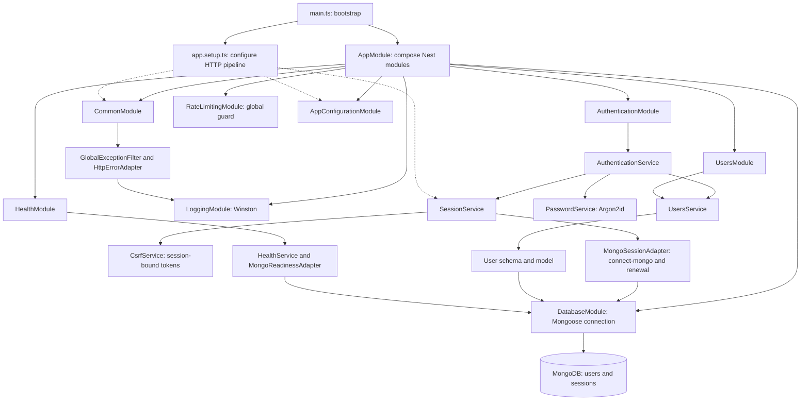
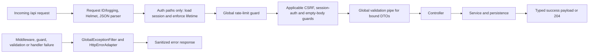

# Backend architecture

[Documentation index](README.md) · [Whole system](system.md) · [Frontend](frontend.md)

## Module connections

`AppModule` assembles the application; individual module files declare their providers/imports. Configuration and logging support the feature modules. Controllers handle HTTP concerns, the authentication service coordinates behavior, and `UsersService` owns user persistence and public-user projection. MongoDB/session details stay in their adapters rather than spreading into controllers.

## Request processing

This diagram shows the main stages, not every route-specific branch. The session middleware is mounted on `/api/auth`; health does not require a session. The controller's CSRF guard checks state-changing requests, `SessionAuthGuard` protects `/auth/me`, and `EmptyBodyGuard` rejects unexpected sign-out body fields. The global throttle runs before controller guards. Bound signup/sign-in DTOs are transformed and validated, with unknown properties rejected.

Responses keep endpoint-specific success shapes such as `{ user }` or `{ user, csrfToken }`; they are not wrapped in another success envelope. Errors use `{ code, message, fieldErrors? }`, with readiness also including database checks. Raw exceptions and credentials do not appear in HTTP responses or diagnostic logs.

## Authentication responsibilities

- **User persistence:** the schema excludes `passwordHash` from default selection and has a unique email index. `UsersService` awaits index initialization, explicitly selects hashes only for credential lookup, handles concurrent duplicate registration, and returns public projections.
- **Password protection:** `PasswordService` asynchronously hashes/verifies with Argon2id and performs dummy verification for unknown accounts. Unknown accounts and wrong passwords produce the same sign-in error.
- **Session handling:** `SessionService` configures `express-session`, regenerates sessions on authentication, rotates CSRF tokens, and saves before returning success. It enforces 30-minute idle and 24-hour absolute lifetimes server-side, and destroys sessions/clears cookies on logout.
- **Session persistence:** `MongoSessionAdapter` shares Mongoose's client with `connect-mongo`, ensures the expiry index exists, and renews activity using an atomic update without upsert. A late read cannot recreate a session deleted by logout. MongoDB TTL cleanup complements the explicit server expiry checks.
- **CSRF and transport:** `CsrfService` checks session-bound tokens and supplied origins. Production requires HTTPS, host-only `__Host-eg.sid` Secure/HttpOnly/SameSite=Lax cookies, and deliberate trust of the single reverse proxy. Local/test mode explicitly permits loopback HTTP.
- **Readiness:** `HealthService` delegates to `MongoReadinessAdapter`. HTTP error construction and database failure translation stay out of its main success path. Initial database failure leaves readiness available with `503`; restart the API after restoring a failed initial connection.

## Important files

Paths below are relative to `apps/backend/src`.

| File                                                                                                                                     | Responsibility                                                                                                                               |
| ---------------------------------------------------------------------------------------------------------------------------------------- | -------------------------------------------------------------------------------------------------------------------------------------------- |
| [main.ts](../apps/backend/src/main.ts)                                                                                                   | Create Nest/Express, attach the Nest Winston logger, configure shutdown hooks, and start listening. Startup failures use sanitized messages. |
| [app.module.ts](../apps/backend/src/app.module.ts)                                                                                       | Root module composition.                                                                                                                     |
| [app.setup.ts](../apps/backend/src/app.setup.ts)                                                                                         | `/api` prefix, proxy trust, logging middleware, Helmet, 16 KiB JSON limit, validation, sessions, and local-only Swagger.                     |
| [common/common.module.ts](../apps/backend/src/common/common.module.ts)                                                                   | Register the injected global exception filter and shared request logging.                                                                    |
| [common/filters/global-exception.filter.ts](../apps/backend/src/common/filters/global-exception.filter.ts)                               | Catch HTTP failures, emit safe diagnostics, and send non-cacheable error responses.                                                          |
| [common/adapters/http-error.adapter.ts](../apps/backend/src/common/adapters/http-error.adapter.ts)                                       | Translate exceptions into the common public error contract.                                                                                  |
| [common/errors/application.error.ts](../apps/backend/src/common/errors/application.error.ts)                                             | Mark deliberately public application errors while retaining internal causes separately.                                                      |
| [common/pipes/api-validation.pipe.ts](../apps/backend/src/common/pipes/api-validation.pipe.ts)                                           | Configure DTO validation and consistent field errors.                                                                                        |
| [common/rate-limiting.module.ts](../apps/backend/src/common/rate-limiting.module.ts)                                                     | Global 100-request/minute/IP budget and shared signup/sign-in ten-attempt/minute/IP budget. Counters are process-local.                      |
| [modules/authentication/authentication.controller.ts](../apps/backend/src/modules/authentication/authentication.controller.ts)           | Route handlers, DTO bindings, guards, status codes, and Swagger metadata.                                                                    |
| [modules/authentication/authentication.service.ts](../apps/backend/src/modules/authentication/authentication.service.ts)                 | Coordinate user creation/lookup, password operations, session establishment, and current-user responses.                                     |
| [modules/authentication/services/session.service.ts](../apps/backend/src/modules/authentication/services/session.service.ts)             | Session middleware, cookie policy, lifetime enforcement, regeneration, saving, and destruction.                                              |
| [modules/authentication/adapters/mongo-session.adapter.ts](../apps/backend/src/modules/authentication/adapters/mongo-session.adapter.ts) | Mongo-backed session store, expiry index, atomic activity renewal, and dependency error translation.                                         |
| [modules/authentication/services/password.service.ts](../apps/backend/src/modules/authentication/services/password.service.ts)           | Argon2id hashing and real/dummy verification.                                                                                                |
| [modules/authentication/services/csrf.service.ts](../apps/backend/src/modules/authentication/services/csrf.service.ts)                   | Token generation/rotation, token validation, and origin checking.                                                                            |
| [modules/users/users.service.ts](../apps/backend/src/modules/users/users.service.ts)                                                     | User queries, index readiness, public-user projection, duplicate/dependency errors.                                                          |
| [modules/users/schemas/user.schema.ts](../apps/backend/src/modules/users/schemas/user.schema.ts)                                         | User persistence fields, timestamps, unique email index, and restricted hash selection.                                                      |
| [modules/configuration/environment.ts](../apps/backend/src/modules/configuration/environment.ts)                                         | Validate and normalize environment configuration before use.                                                                                 |
| [modules/database/database.module.ts](../apps/backend/src/modules/database/database.module.ts)                                           | Mongoose connection setup and sanitized connection event logging.                                                                            |
| [modules/database/adapters/mongo-readiness.adapter.ts](../apps/backend/src/modules/database/adapters/mongo-readiness.adapter.ts)         | Database ping and sanitized readiness failure translation.                                                                                   |
| [modules/logging/logging.module.ts](../apps/backend/src/modules/logging/logging.module.ts)                                               | Structured Winston transport and Nest logger integration.                                                                                    |

DTOs live inside their feature modules; public response DTOs are separate from database records. Common error/session contracts live in `common/types`. Application contracts use `Req`/`Res` naming, while framework types keep their library names.

Backend tests live in [apps/backend/test](../apps/backend/test). Authentication integration tests launch a native Node fixture against a separate real MongoDB database. The fixture's IPC controls are test-only and are not HTTP endpoints in the production application.
