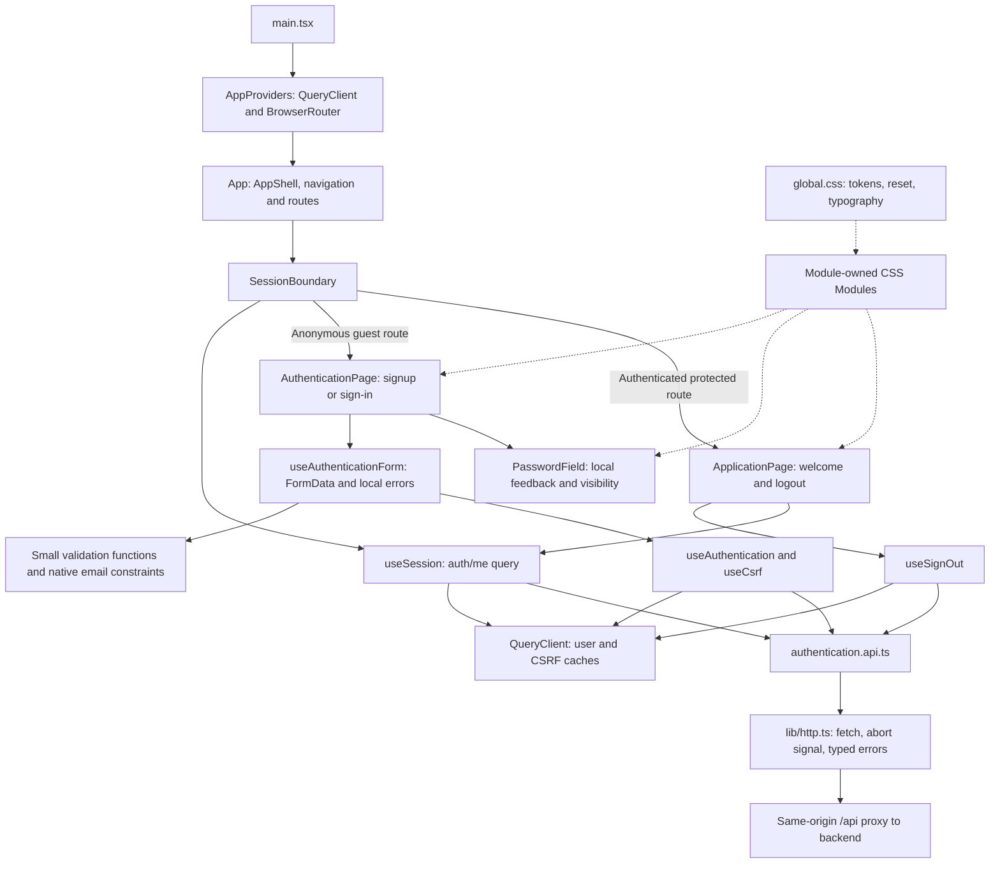
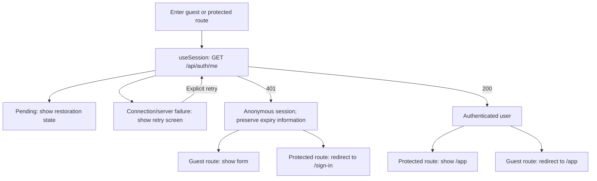

# Frontend architecture

[Documentation index](README.md) · [Whole system](system.md) · [Backend](backend.md)

## Components and data flow

The authentication module owns its pages, components, hooks, API contracts, validation, and styles. The application module owns the protected welcome page and its styles, and consumes authentication hooks for session display and logout. Shared UI and transport utilities live outside feature modules.

## Routing and session restoration

`SessionBoundary` waits for restoration before deciding whether to redirect. A network failure does not become an anonymous session. The current user lives in TanStack Query under `['auth', 'me']`, stays fresh for 60 seconds, and revalidates on focus/reconnection. Guest and protected routes read the same cache rather than maintaining another authentication state container.

## Forms and performance

Inputs remain native and uncontrolled. `useAuthenticationForm` reads `FormData` only on submission, validates on blur/submission, and holds errors and submission feedback in local state. The first invalid field receives focus. A synchronous ref prevents duplicate submissions before React has rerendered the pending state.

`PasswordField` owns live password guidance and visibility state, keeping those keystroke updates local. Module CSS consumes global variables. There is no React Hook Form, Zod, frontend `validator`, persistent authentication storage, or speculative memoization.

## Authentication transitions

On successful signup/sign-in, `replaceSession` cancels queries marked `meta: { private: true }`, removes other private cached data, and replaces the current-user entry with the server response. The mutation then stores the rotated CSRF token. On successful logout, it installs an anonymous session and removes the CSRF cache. Future private query functions must forward their abort signal through the HTTP client.

A failed logout retains the current-user cache and displays retry feedback. Authentication mutations do not retry automatically. An invalid CSRF token triggers token recovery, then requires an explicit resubmission. Mutation state is reset after form submission and uses `gcTime: 0` to avoid retaining completed credentials in the mutation cache.

## Important files

Paths below are relative to `apps/frontend/src`.

| File                                                                                                                                                  | Responsibility                                                                                                                                                                           |
| ----------------------------------------------------------------------------------------------------------------------------------------------------- | ---------------------------------------------------------------------------------------------------------------------------------------------------------------------------------------- |
| [app/AppProviders.tsx](../apps/frontend/src/app/AppProviders.tsx)                                                                                     | Construct the QueryClient and configure routing, freshness, refetching, and retry defaults.                                                                                              |
| [app/App.tsx](../apps/frontend/src/app/App.tsx)                                                                                                       | Compose shared layout/navigation and `/sign-up`, `/sign-in`, `/app`, fallback routes.                                                                                                    |
| [components/AppShell/AppShell.tsx](../apps/frontend/src/components/AppShell/AppShell.tsx)                                                             | Shared page shell; feature navigation is passed through composition.                                                                                                                     |
| [modules/authentication/components/SessionBoundary.tsx](../apps/frontend/src/modules/authentication/components/SessionBoundary.tsx)                   | Restoration, connection retry, and guest/protected redirects.                                                                                                                            |
| [modules/authentication/pages/AuthenticationPage.tsx](../apps/frontend/src/modules/authentication/pages/AuthenticationPage.tsx)                       | Accessible signup/sign-in form markup and hook integration.                                                                                                                              |
| [modules/authentication/hooks/useAuthenticationForm.ts](../apps/frontend/src/modules/authentication/hooks/useAuthenticationForm.ts)                   | FormData, validation, submit guard, API error mapping, and focus management.                                                                                                             |
| [modules/authentication/components/PasswordField.tsx](../apps/frontend/src/modules/authentication/components/PasswordField.tsx)                       | Isolated visibility controls and password requirements feedback.                                                                                                                         |
| [modules/authentication/hooks/useSession.ts](../apps/frontend/src/modules/authentication/hooks/useSession.ts)                                         | Current-user query and `401`/expiry interpretation.                                                                                                                                      |
| [modules/authentication/hooks/useAuthentication.ts](../apps/frontend/src/modules/authentication/hooks/useAuthentication.ts)                           | CSRF acquisition, signup/sign-in/logout mutations, and cache updates.                                                                                                                    |
| [modules/authentication/hooks/session-cache.ts](../apps/frontend/src/modules/authentication/hooks/session-cache.ts)                                   | Cancel private requests and replace session data without late-response restoration.                                                                                                      |
| [modules/authentication/api/authentication.api.ts](../apps/frontend/src/modules/authentication/api/authentication.api.ts)                             | Feature-specific endpoint calls with `Req`/`Res` contracts from the module's types file.                                                                                                 |
| [lib/http.ts](../apps/frontend/src/lib/http.ts)                                                                                                       | Same-origin fetch, JSON/204 handling, abort signals, and normalized API errors. TypeScript contracts describe expected success payloads; they are not runtime success-schema validation. |
| [modules/authentication/validation/authentication.validation.ts](../apps/frontend/src/modules/authentication/validation/authentication.validation.ts) | Small field/form validators; backend validation remains authoritative.                                                                                                                   |
| [modules/application/pages/ApplicationPage.tsx](../apps/frontend/src/modules/application/pages/ApplicationPage.tsx)                                   | Protected welcome screen, current-user display, and recoverable logout.                                                                                                                  |
| [styles/global.css](../apps/frontend/src/styles/global.css)                                                                                           | Global design variables, resets, and base typography; feature rules remain in their CSS Modules.                                                                                         |

Component tests live in [apps/frontend/test](../apps/frontend/test). The real API integration test checks contract behavior against the backend; [e2e](../e2e) adds browser cookie, refresh, navigation, failure, and responsive coverage.
