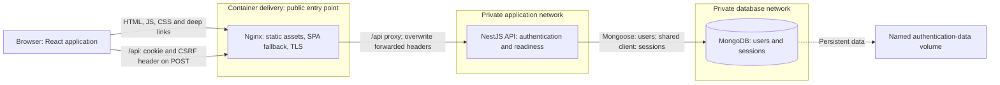
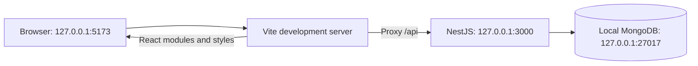
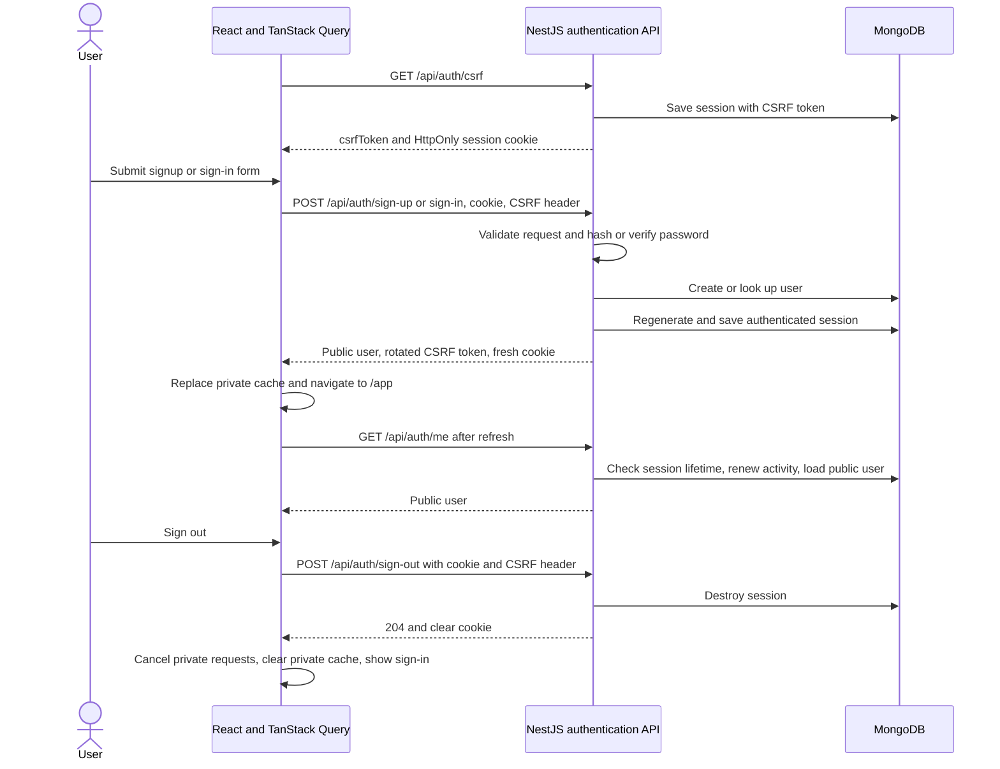

# Whole-system architecture

[Documentation index](README.md) · [Frontend](frontend.md) · [Backend](backend.md)

## Runtime components

The browser loads the React application, then calls `/api` on the same origin. The frontend server forwards those requests to NestJS. User records and server-side sessions live in MongoDB; the browser holds an HttpOnly session cookie rather than an authentication token in browser storage.

Only Nginx publishes a host port. The API joins both private networks, while MongoDB joins only the internal database network. The API trusts one proxy hop in this topology. Production uses HTTPS and Secure cookies; the explicit local override permits localhost HTTP.

Development replaces Nginx with Vite and runs NestJS directly:

The development database may run through `compose.dev.yaml` or as a local MongoDB server. Its volume is separate from the authenticated container-delivery database. Vite preview is used for build inspection and browser tests; Nginx serves the production build.

## Authentication lifecycle

The sequence combines signup and sign-in: signup hashes the password and creates a user; sign-in looks up credentials and verifies the supplied password. Session regeneration prevents reuse of the pre-authentication session identifier. Idle expiry is 30 minutes, with a 24-hour absolute lifetime checked by the server. A failed logout leaves the client able to retry; private cache cleanup follows server-confirmed success.

## Important files

| File or directory                                                                         | Responsibility                                                                                |
| ----------------------------------------------------------------------------------------- | --------------------------------------------------------------------------------------------- |
| [package.json](../package.json) and [package-lock.json](../package-lock.json)             | Workspace commands and locked dependencies for both applications.                             |
| [apps/frontend/src/main.tsx](../apps/frontend/src/main.tsx)                               | Mount the React application and its providers.                                                |
| [apps/backend/src/main.ts](../apps/backend/src/main.ts)                                   | Bootstrap NestJS, configure the HTTP application, and listen on the validated host/port.      |
| [compose.dev.yaml](../compose.dev.yaml)                                                   | Loopback-only development MongoDB.                                                            |
| [compose.yaml](../compose.yaml)                                                           | Production-mode services, private networks, persistent database, and runtime restrictions.    |
| [compose.local.yaml](../compose.local.yaml) / [compose.https.yaml](../compose.https.yaml) | Explicit local HTTP or production HTTPS delivery.                                             |
| [docker/nginx](../docker/nginx)                                                           | Static asset serving, SPA routing, API forwarding, and TLS/security headers.                  |
| [docker/mongodb/init-users.js](../docker/mongodb/init-users.js)                           | Initialize a database-scoped application account separately from the bootstrap administrator. |
| [scripts/container-smoke.mjs](../scripts/container-smoke.mjs)                             | Verify disposable HTTP/HTTPS stacks, persistence, permissions, and browser sessions.          |
| [.github/workflows/verify.yaml](../.github/workflows/verify.yaml)                         | Run checks, builds, application tests, and container verification in CI.                      |

## Boundaries and extension points

Public users contain only `id`, `email`, and `name`. Password hashes remain on the server. Session identifiers are in host-only HttpOnly cookies; CSRF tokens remain in client memory and are sent explicitly on state-changing requests. Same-origin proxies remove the need for a separate browser CORS configuration.

The deployment targets one API instance. MongoDB sessions are shared-capable, but the rate limiter is process-local: multiple API instances require a shared limiter, a common session secret, and deliberate proxy/network configuration. There are no scheduled jobs, realtime channels, or shared-types workspace in this submission.
